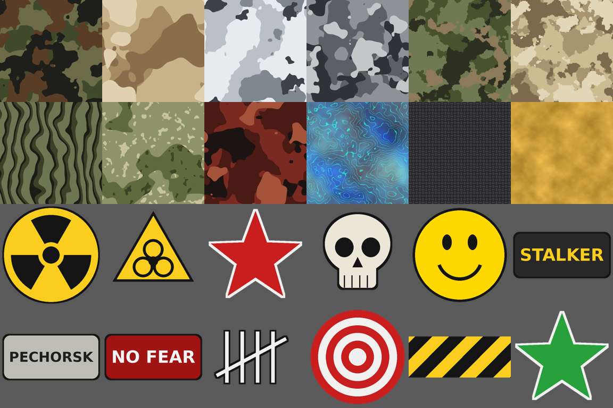

# Camo & Stickers — Into the Radius 2

Мод для **Into the Radius 2**: камуфляжная окраска и наклейки для оружия прямо в игре.

- **12 камуфляжей**: Woodland, Desert, Snow, Urban, Digital Forest, Digital Desert, Tiger, Flora («Берёзка»), Hunter Red, Anomaly, Carbon, Gold.
- **12 наклеек**: радиация, биоугроза, красная звезда, череп, смайлик, «STALKER», «PECHORSK», «NO FEAR», счёт убийств, мишень, предупреждающие полосы, зелёная звезда.
- Камуфляж **ложится поверх родной текстуры**, а не вместо неё: царапины и детали частично просвечивают. Силу покрытия и масштаб узора можно менять.
- Наклейки можно **двигать, масштабировать и вращать** с нумпада, их можно перенести на другую часть оружия (ствольная коробка, приклад и т. д.).
- Выбор **сохраняется для каждого типа оружия** (`presets.lua`) и автоматически применяется ко всем стволам этого типа, в том числе к новым: у торговца, в тайнике, после загрузки сохранения.
- **Свои камуфляжи и картинки**: PNG, JPG, BMP или TGA. Положите файл в папку мода или в любую свою папку, нажмите **Shift+Insert**, и он появится в игре без перезапуска.



## Требования

- Into the Radius 2 (Steam, PC VR).
- **UE4SS** для ITR2, например UE4SS-пак с Nexus Mods ([intotheradius2/mods/128](https://www.nexusmods.com/intotheradius2/mods/128)).

## Установка

1. Установите UE4SS для ITR2.
2. Распакуйте архив `CamoAndStickers-x.y.z.zip` в папку игры, рядом с `IntoTheRadius2.exe`.
   Мод должен оказаться здесь:
   ```
   <игра>\IntoTheRadius2\Binaries\Win64\ue4ss\Mods\CamoAndStickers\
       enabled.txt
       Scripts\main.lua
       Scripts\config.lua
       Camo\*.png
       Stickers\*.png
   ```
   Если ваша сборка UE4SS держит моды в `Binaries\Win64\Mods`, положите папку туда.
3. Если ваша версия UE4SS не читает `enabled.txt`, добавьте строку `CamoAndStickers : 1` в `Mods\mods.txt`.
4. Запустите игру. В консоли или логе UE4SS (`UE4SS.log`) должна появиться строка
   `[CamoAndStickers] Loaded: 12 camos, 12 stickers ...`.

## Управление

Возьмите оружие в руку или поднесите его к лицу: мод выбирает ближайший к камере ствол в пределах 1,5 м. Клавиши жмите на клавиатуре.

| Клавиша | Действие |
|---|---|
| **F5** / **Shift+F5** | следующий / предыдущий камуфляж (включая «без камуфляжа») |
| **F6** / **Shift+F6** | сменить картинку активной наклейки |
| **F7** | добавить наклейку |
| **Shift+F7** | удалить активную наклейку |
| **F8** | выбрать следующую наклейку для редактирования |
| **Shift+F8** | перенести наклейку на другую текстуру оружия (приклад, цевьё…) |
| **F9** | масштаб камуфляжа (1×, 2×, 3×, 4×, 6×) |
| **F10** | сила покрытия камуфляжа (55 %, 70 %, 85 %, 100 %) |
| **Num 4 / 6 / 8 / 2** | двигать наклейку влево / вправо / вверх / вниз |
| **Num + / Num −** | увеличить / уменьшить наклейку |
| **Num 7 / Num 9** | повернуть наклейку |
| **Delete** | сбросить оружие к заводскому виду |
| **Insert** | диагностика: список ближайших объектов и материалов оружия в лог |
| **Shift+Insert** | перечитать папки с картинками и `presets.lua` (новые и изменённые файлы подхватываются сразу) |

Все клавиши переназначаются в `Scripts\config.lua`.

### Как приклеить наклейку туда, куда хочется

Наклейки рисуются в UV-пространстве текстуры оружия. У каждой модели своя развёртка, поэтому новая наклейка сначала появляется в одной из стандартных точек. Дальше:

1. Нажмите **F7**, затем **F6**, пока не найдёте нужную картинку.
2. Если наклейки не видно, она попала на невидимый участок или на другую часть модели. Двигайте её с нумпада или нажмите **Shift+F8**, чтобы перенести на другую текстуру.
3. Подгоните размер (**Num +/−**) и поворот (**Num 7/9**). Всё сохраняется сразу.

## Свои камуфляжи и наклейки

### Быстрый способ

1. Положите картинку в папку мода:
   - камуфляж в `...\Mods\CamoAndStickers\Camo\`;
   - наклейку в `...\Mods\CamoAndStickers\Stickers\`.
2. В игре нажмите **Shift+Insert**. В логе появится `Reloaded: N camos, M stickers`.
3. Возьмите оружие и листайте **F5** (камуфляж) или **F6** (наклейка), пока не дойдёте до своей.

Форматы: **PNG, JPG, BMP, TGA**. Название в игре берётся из имени файла. Список сортируется по алфавиту, поэтому номер в начале имени (`13_MyCamo.png`) задаёт порядок.

Если отредактировали уже загруженную картинку, снова нажмите **Shift+Insert**: текстура перечитается с диска, и оружие перекрасится.

### Своя папка где угодно

Картинки можно держать и вне игры, например в «Изображениях», чтобы они пережили переустановку. Пропишите папки в `Scripts\config.lua`:

```lua
CustomCamoFolders    = { [[C:\Users\Me\Pictures\ITR2 Camo]] },
CustomStickerFolders = { [[C:\Users\Me\Pictures\ITR2 Stickers]] },
```

Папок может быть несколько. Если имя файла совпадает со встроенным (`01_Woodland.png`), ваш файл заменит встроенный.

Используйте в путях и именах файлов **латиницу**: кириллица в пути может не прочитаться.

### Какие картинки подходят

- **Камуфляж**: квадратный, 512–2048 px, лучше бесшовный (края совпадают). Иначе при тайлинге будут видны швы; уберите их масштабом **F9** = 1× или утилитой ниже.
- **Наклейка**: PNG с прозрачным фоном. Подойдёт любой размер; мод сохраняет пропорции, так что можно и прямоугольную. Оптимально до 512 px.

### Утилита подготовки (необязательно)

`tools/prepare_image.py` делает из любой картинки готовую текстуру. Нужны Python, Pillow и numpy (`pip install pillow numpy`).

```bash
# Камуфляж из любого фото или узора: обрезка в квадрат, 1024 px, бесшовные края
python tools/prepare_image.py camo photo.jpg
# Идеально бесшовный зеркальный вариант, 2048 px
python tools/prepare_image.py camo pattern.png --mirror --size 2048

# Наклейка из логотипа на белом фоне: убрать фон, обрезать поля, белая обводка
python tools/prepare_image.py sticker logo.jpg --remove-bg --outline 6
# Сохранить сразу в свою папку
python tools/prepare_image.py sticker logo.png --out "C:/Users/Me/Pictures/ITR2 Stickers"
```

Без `--out` результат кладётся в `CamoAndStickers/Camo` или `CamoAndStickers/Stickers`.

Встроенные текстуры генерируются скриптом `tools/generate_textures.py`.

## Настройки (`Scripts\config.lua`)

- `Mode`: `"composite"` (камуфляж поверх родной текстуры плюс наклейки, по умолчанию) или `"replace"` (текстура просто заменяется камуфляжем, наклеек нет; самый совместимый режим).
- `RenderTargetSize`: разрешение итоговой текстуры, 1024 или 2048.
- `DefaultCamoStrength`, `DefaultCamoScale` и шаги для F9/F10.
- `WeaponClassPatterns` / `WeaponClassExcludePatterns`: по каким именам классов мод узнаёт оружие.
- `BaseColorParamNames`: имена параметра базового цвета в материалах.
- `TargetMaxDistance`: на каком расстоянии от камеры искать оружие.

## Если что-то не работает

Нажмите **Insert**, держа оружие в руке, и откройте `UE4SS.log`:

- **«No weapon within 150 cm»**: класс оружия не подошёл под шаблоны. В списке ближайших объектов найдите класс своего ствола и добавьте часть его имени в `WeaponClassPatterns`. Если к оружию прилипает лишнее (магазины, коробки), допишите это в `WeaponClassExcludePatterns`.
- **В строке `texture params` нет параметра цвета**: впишите нужное имя первым в `BaseColorParamNames`.
- **`(none listed, plain material)`**: у материала нет инстанса с параметрами. Мод перебирает стандартные имена вслепую, и это может не сработать.
- **В логе «falling back to 'replace' mode»**: отрисовка на canvas не сработала в этой версии движка. Камуфляж будет работать в режиме замены, наклейки нет.
- **Своя картинка не появилась**: проверьте строку `Reloaded: N camos...` в логе. Если число не выросло, проверьте расширение (png/jpg/bmp/tga), путь в `CustomCamoFolders` и отсутствие кириллицы в пути. Если появилась строка `Failed to load texture`, файл повреждён или в неподдерживаемом формате: пересохраните его как PNG.
- **При Shift+Insert на мгновение мелькает чёрное окно**: так мод читает список файлов в ваших папках (команда `dir`). Это безопасно.
- **Оружие стало чёрным, розовым или однотонным**: материал оружия использует virtual texture или другой тип сэмплера. Поставьте `Mode = "replace"` или сбросьте этот ствол клавишей **Delete**.

## Совместимость и честное предупреждение

Мод работает на UE4SS Lua и ничего не меняет в файлах игры. Удалите папку мода, и всё вернётся как было. `presets.lua` хранит только ваши настройки.

Мод написан без доступа к файлам игры, поэтому имена классов оружия и параметров материалов подобраны по типичным для UE5 соглашениям. Логика мода проверена offline-тестом на заглушках UE4SS (`lua5.4 tools/test/run_mock.lua`), но не в самой игре. Если на вашей версии ITR2 мод не узнаёт оружие или не видит текстуру, клавиша **Insert** подскажет, что вписать в `config.lua`.

## Мультиплеер (кооператив)

**Коротко: мод работает только у вас на экране, по сети ничего не передаётся.**

- **Чужой камуфляж вы не видите, ваш не видят другие.** Мод меняет материалы оружия локально, на вашем компьютере. Хост и другие игроки получают по сети только сам предмет (какой это ствол, где он лежит), а не его материалы. Синхронизация потребовала бы поддержки со стороны самой игры, Lua-мод так не умеет.
- **Пресет действует на тип оружия, а не на конкретный ствол.** Если вы покрасили АКМ, у вас на экране будут покрашены все АКМ, в том числе в руках у напарников.
- **Можно играть, когда у других мода нет.** Мод не трогает игровую логику и сохранения, так что рассинхрона из-за него быть не должно. Хост может играть без мода, клиент с модом, и наоборот.
- **Как сделать «командный» камуфляж.** Все ставят мод и кладут себе одинаковые `presets.lua` и одинаковые картинки (одна и та же папка `Camo`/`Stickers`, или общая папка в облаке, прописанная в `CustomCamoFolders`). Тогда у каждого на экране будет один и тот же вид. Индивидуальные «у меня свой, у тебя свой» на одном типе оружия так сделать нельзя.
- **Античит и баны.** Мод работает через UE4SS, как и остальные ITR2-моды на Nexus. Правила конкретного сервера или сообщества проверяйте сами.

## Для разработчиков

```
CamoAndStickers/            папка мода (кладётся в ue4ss/Mods)
  Scripts/main.lua          логика мода
  Scripts/config.lua        настройки
  Camo/, Stickers/          PNG-текстуры
tools/generate_textures.py  генератор встроенных камуфляжей и наклеек
tools/prepare_image.py      подготовка своих картинок (бесшовность, удаление фона)
tools/build_release.py      сборка dist/CamoAndStickers-<версия>.zip
tools/test/run_mock.lua     offline-тест на заглушках UE4SS
```

Как это работает: для каждого слота материала оружия создаётся `MaterialInstanceDynamic`. Его родитель — исходный материал, а параметр базового цвета получает `TextureRenderTarget2D`. В этот render target через `BeginDrawCanvasToRenderTarget` рисуются родная текстура, камуфляж (полупрозрачно, с тайлингом) и наклейки. PNG загружаются в рантайме через `KismetRenderingLibrary::ImportFileAsTexture2D`. Render target общий для всех стволов одного типа с одинаковым пресетом.
