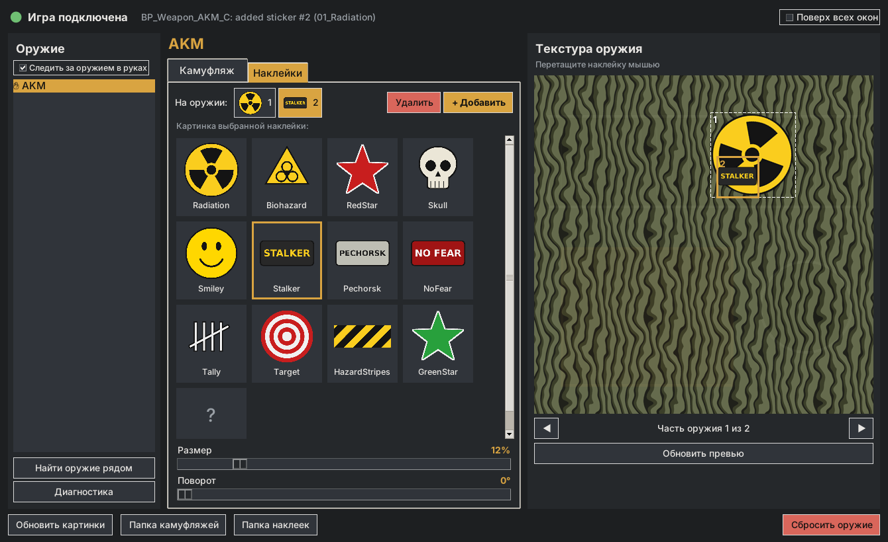

# Camo & Stickers — Into the Radius 2

Мод для **Into the Radius 2** (одиночная игра): камуфляжная окраска и наклейки для оружия. Управление — **в окне панели**, мышкой, без горячих клавиш, поэтому мод не конфликтует с другими модами.

- **12 камуфляжей**: Woodland, Desert, Snow, Urban, Digital Forest, Digital Desert, Tiger, Flora («Берёзка»), Hunter Red, Anomaly, Carbon, Gold.
- **12 наклеек**: радиация, биоугроза, красная звезда, череп, смайлик, «STALKER», «PECHORSK», «NO FEAR», счёт убийств, мишень, предупреждающие полосы, зелёная звезда.
- Камуфляж **ложится поверх родной текстуры**: царапины и детали частично просвечивают. Сила покрытия и масштаб узора настраиваются ползунками.
- Наклейки **перетаскиваются мышью** прямо на превью текстуры оружия, размер и поворот — ползунками. Наклейку можно перенести на другую часть оружия (ствольная коробка, приклад…).
- Выбор **сохраняется для каждого типа оружия** и автоматически применяется ко всем стволам этого типа, в том числе к новым: у торговца, в тайнике, после загрузки сохранения.
- **Свои камуфляжи и картинки**: PNG, JPG, BMP или TGA. Положите файл в папку, нажмите в панели «Обновить картинки» — и он доступен без перезапуска игры.



## Требования

- Into the Radius 2 (Steam, PC VR).
- **UE4SS** для ITR2, например UE4SS-пак с Nexus Mods ([intotheradius2/mods/128](https://www.nexusmods.com/intotheradius2/mods/128)).
- **Python 3** для панели управления: [python.org](https://www.python.org/downloads/), при установке отметьте **«Add python.exe to PATH»**. Больше ничего ставить не нужно; Pillow (`pip install pillow`) необязателен — с ним в панели видны превью JPG/BMP/TGA и картинка чуть чётче.

## Установка

1. Установите UE4SS для ITR2.
2. Распакуйте архив `CamoAndStickers-x.y.z.zip` в папку игры, рядом с `IntoTheRadius2.exe`. Мод должен оказаться здесь:
   ```
   <игра>\IntoTheRadius2\Binaries\Win64\ue4ss\Mods\CamoAndStickers\
       CamoPanel.bat       ← запуск панели управления
       CamoPanel.pyw
       enabled.txt
       Scripts\main.lua, config.lua
       Camo\*.png
       Stickers\*.png
       Panel\              (служебная папка для связи панели и игры)
   ```
   Если ваша сборка UE4SS держит моды в `Binaries\Win64\Mods`, положите папку туда.
3. Если ваша версия UE4SS не читает `enabled.txt`, добавьте строку `CamoAndStickers : 1` в `Mods\mods.txt`.
4. Для удобства создайте ярлык `CamoPanel.bat` на рабочем столе.

## Как пользоваться

1. Запустите игру и загрузите сохранение.
2. Запустите **`CamoPanel.bat`**. Вверху панели загорится зелёная точка «Игра подключена».
3. Возьмите оружие в руку. Панель сама выберет его (галочка «Следить за оружием в руках»). Можно и выбрать любое оружие из списка слева — например, лежащее рядом на столе.
4. **Вкладка «Камуфляж»**: нажмите на узор. Ползунки — масштаб узора и сила покрытия.
5. **Вкладка «Наклейки»**: «+ Добавить», затем нажмите на нужную картинку. Справа на текстуре оружия **перетащите рамку наклейки мышью** туда, где ей место. Ползунки — размер и поворот. Номера над списком переключают, какую наклейку вы правите.
6. «Сбросить оружие» возвращает заводской вид.

Изменения применяются в игре сразу и сохраняются автоматически.

### Как открыть панель, не снимая шлем

Панель — обычное окно Windows. В VR его видно через «рабочий стол» шлема:

- **SteamVR**: кнопка меню → «Рабочий стол» (Desktop), можно закрепить окно рядом с собой;
- **Meta Quest Link / Air Link**: меню Oculus Dash → «Рабочий стол»;
- **Virtual Desktop**: рабочий стол доступен по кнопке меню.

Галочка «Поверх всех окон» держит панель над игрой.

### Про превью и «части оружия»

Справа показана **развёрнутая текстура** оружия (UV-развёртка) с вашим камуфляжем и наклейками — так их и видит игра. У многих стволов несколько текстур (ствольная коробка, приклад, цевьё): переключайте их стрелками **◀ ▶** под превью. Выбранная наклейка переезжает на показанную часть.

Подсказка: если наклейка в игре не видна, её рамка попала на неиспользуемый участок развёртки — сдвиньте её на заметную деталь.

## Свои камуфляжи и наклейки

1. В панели нажмите «Папка камуфляжей» или «Папка наклеек» и положите туда картинку.
2. Нажмите **«Обновить картинки»**. Новая картинка появится в списке.

Форматы: **PNG, JPG, BMP, TGA**. Название берётся из имени файла. Список сортируется по алфавиту, так что номер в начале имени (`13_MyCamo.png`) задаёт порядок. Отредактировали уже используемую картинку — снова нажмите «Обновить картинки», оружие перекрасится.

**Своя папка где угодно** (например, в «Изображениях», чтобы пережила переустановку) — пропишите её в `Scripts\config.lua`:

```lua
CustomCamoFolders    = { [[C:\Users\Me\Pictures\ITR2 Camo]] },
CustomStickerFolders = { [[C:\Users\Me\Pictures\ITR2 Stickers]] },
```

Если имя файла совпадает со встроенным (`01_Woodland.png`), ваш файл заменит встроенный. В путях и именах файлов используйте **латиницу**.

**Какие картинки подходят:**

- **Камуфляж**: квадратный, 512–2048 px, лучше бесшовный (края совпадают), иначе при повторении узора будут видны швы.
- **Наклейка**: PNG с прозрачным фоном; пропорции сохраняются, можно и прямоугольную. Оптимально до 512 px.

**Утилита подготовки** `tools/prepare_image.py` (лежит в репозитории мода, не в архиве; нужны `pip install pillow numpy`) делает из любой картинки готовую текстуру:

```bash
python tools/prepare_image.py camo photo.jpg                          # бесшовный камуфляж 1024 px
python tools/prepare_image.py camo pattern.png --mirror --size 2048   # зеркальный, идеально бесшовный
python tools/prepare_image.py sticker logo.jpg --remove-bg --outline 6  # убрать фон, белая обводка
```

## Настройки (`Scripts\config.lua`)

- `Mode`: `"composite"` (камуфляж поверх родной текстуры плюс наклейки, по умолчанию) или `"replace"` (текстура просто заменяется камуфляжем, без наклеек; самый совместимый режим).
- `RenderTargetSize`: разрешение итоговой текстуры, 1024 или 2048.
- `DefaultCamoStrength`, `DefaultCamoScale`: значения для нового оружия.
- `WeaponClassPatterns` / `WeaponClassExcludePatterns`: по каким именам классов мод узнаёт оружие.
- `BaseColorParamNames`: имена параметра базового цвета в материалах.
- `TargetMaxDistance`: на каком расстоянии от камеры оружие считается «в руках».
- `EnableHotkeys`: горячие клавиши, **по умолчанию выключены**. Если включить, они срабатывают только с **Ctrl+Alt** (Ctrl+Alt+F5 — камуфляж и т. д., список в `Keys`), чтобы не пересекаться с другими модами.

## Если что-то не работает

- **Точка в панели красная, «Нет связи с игрой»**: игра не запущена, сохранение не загружено или мод не загрузился. Проверьте в `UE4SS.log` строку `[CamoAndStickers] Loaded v2.0.0 ...`. Панель должна лежать в той же папке, что и мод.
- **Панель не открывается**: запустите `CamoPanel.pyw` двойным щелчком или командой `python CamoPanel.pyw` из папки мода — так будет видна ошибка. Чаще всего не установлен Python или не отмечен «Add to PATH».
- **Список оружия пуст / «Такого оружия нет рядом»**: подойдите к оружию или возьмите его в руку и нажмите «Найти оружие рядом». Если не помогает — нажмите **«Диагностика»**: панель покажет объекты рядом с вами. Найдите класс своего ствола (без пометки `W`) и добавьте часть его имени в `WeaponClassPatterns`.
- **В диагностике у материала нет параметра цвета** (`base color: nil`): впишите имя из строки `texture params` первым в `BaseColorParamNames`.
- **`(none listed, plain material)`**: у материала нет инстанса с параметрами; мод пробует стандартные имена вслепую, это может не сработать.
- **«Превью работает только в режиме composite»** или в логе «falling back to 'replace' mode»: отрисовка на холсте не сработала в этой версии движка. Камуфляж работает заменой текстуры, наклеек и превью нет.
- **Оружие стало чёрным, розовым или однотонным**: материал использует нестандартный тип текстуры. Поставьте `Mode = "replace"` или сбросьте этот ствол.
- **Своя картинка не появилась**: проверьте расширение, путь в `CustomCamoFolders` и отсутствие кириллицы. Если в логе `Failed to load texture` — пересохраните файл как PNG.

## Совместимость и честное предупреждение

Мод работает на UE4SS Lua и ничего не меняет в файлах игры: удалите папку мода — всё вернётся как было. `presets.lua` хранит только ваши настройки. Мод рассчитан на **одиночную игру**.

Мод написан без доступа к файлам игры, поэтому имена классов оружия и параметров материалов подобраны по типичным для UE5 соглашениям. Логика мода проверена offline-тестом на заглушках UE4SS, а панель — вживую в связке с ним (снимок выше сделан так); в самой игре мод не проверялся. Если мод не узнаёт ваше оружие или его текстуру, кнопка «Диагностика» подскажет, что вписать в `config.lua`.

## Для разработчиков

```
CamoAndStickers/              папка мода (кладётся в ue4ss/Mods)
  Scripts/main.lua            логика мода
  Scripts/config.lua          настройки
  CamoPanel.pyw / .bat        панель управления (Python + tkinter)
  Panel/                      обмен с панелью: commands.txt, state.txt, превью
  Camo/, Stickers/            PNG-текстуры
tools/generate_textures.py    генератор встроенных камуфляжей и наклеек
tools/prepare_image.py        подготовка своих картинок
tools/build_release.py        сборка dist/CamoAndStickers-<версия>.zip
tools/test/run_mock.lua       offline-тест на заглушках UE4SS
```

Тесты: `lua5.4 tools/test/run_mock.lua` и `HOTKEYS=1 lua5.4 tools/test/run_mock.lua`. Чтобы погонять панель без игры: `FAKE_GAME=<пустая папка> lua5.4 tools/test/run_mock.lua` запускает мод на заглушках в этой папке, затем `python <папка>/CamoPanel.pyw` (нужен Pillow для превью).

**Как это работает.** Для каждого слота материала оружия создаётся `MaterialInstanceDynamic` с исходным материалом в роли родителя; параметр базового цвета получает `TextureRenderTarget2D`, в который через `BeginDrawCanvasToRenderTarget` рисуются родная текстура, камуфляж (полупрозрачно, с повтором) и наклейки. PNG загружаются в рантайме через `ImportFileAsTexture2D`, превью для панели сохраняется через `ExportRenderTarget`.

**Протокол панели.** Панель дописывает в `Panel/commands.txt` строки `<номер>\t<команда>\t<аргументы>` (`camo`, `scale`, `strength`, `add_sticker`, `set_sticker`, `remove_sticker`, `reset`, `reload`, `preview`, `diagnostics`, `scan`, `ping`). Мод опрашивает файл каждые 250 мс, выполняет новые строки и пишет `Panel/state.txt` (списки картинок, пресеты, оружие в руках, превью, статус, отметка времени).
